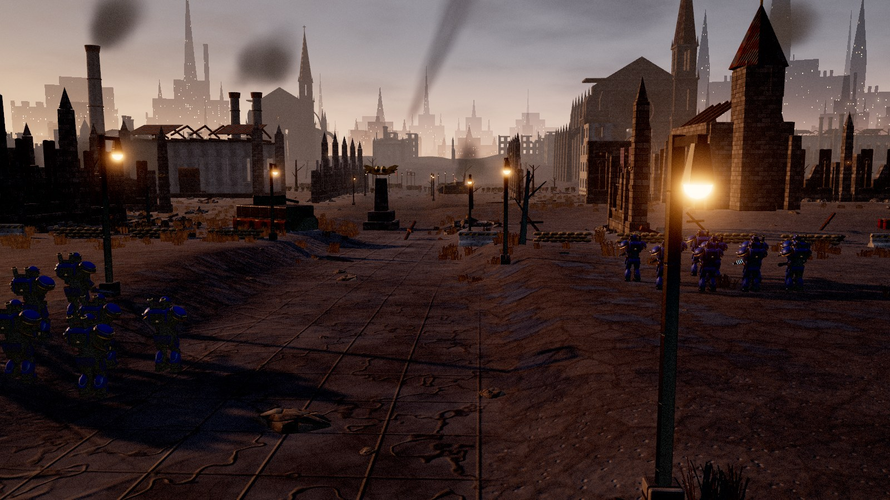
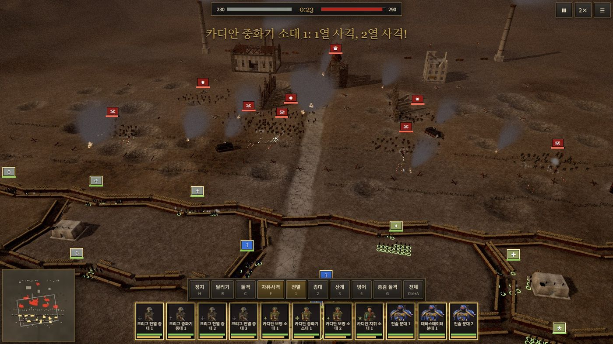
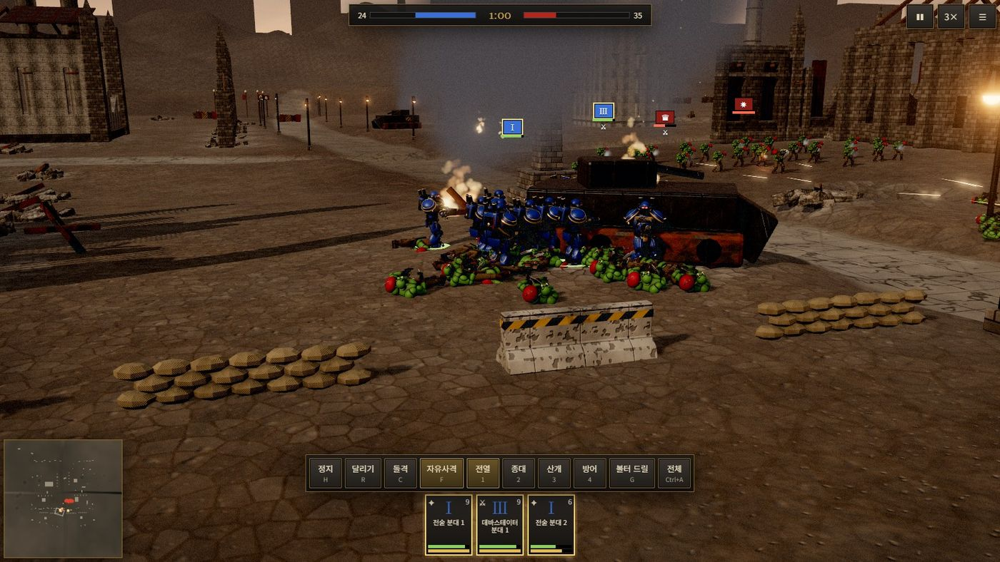
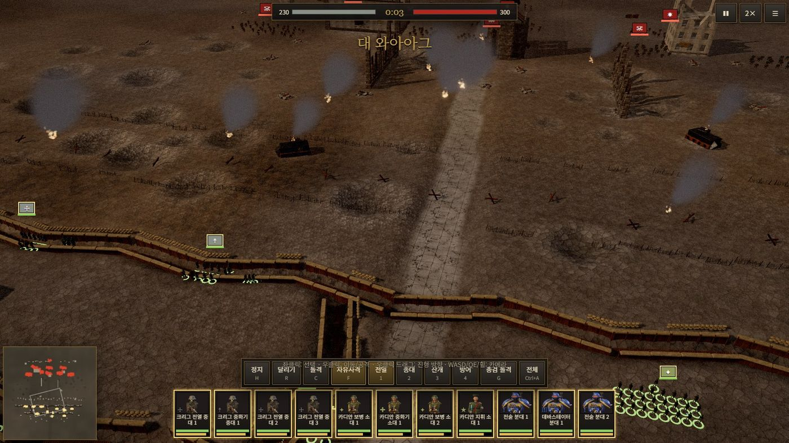
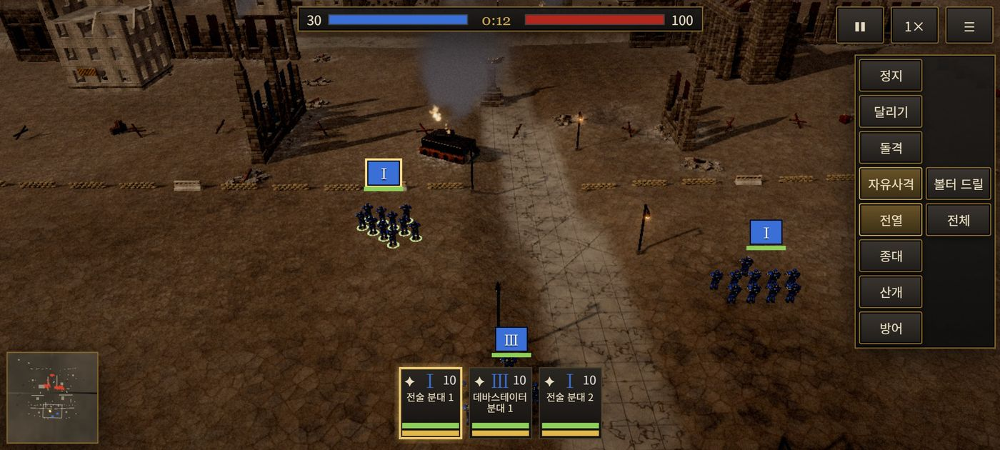
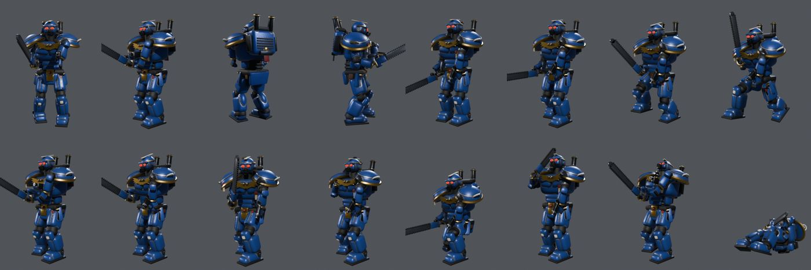
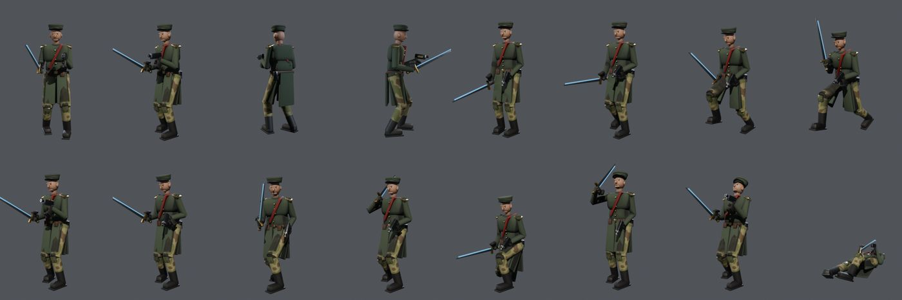
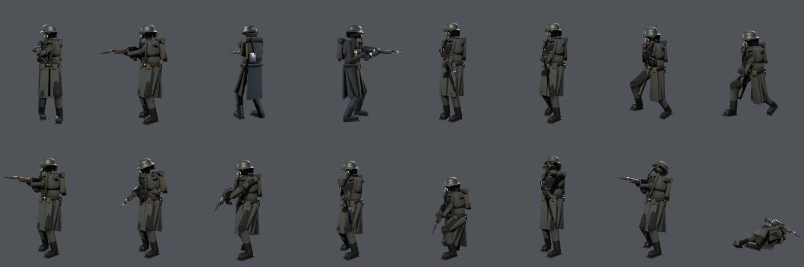
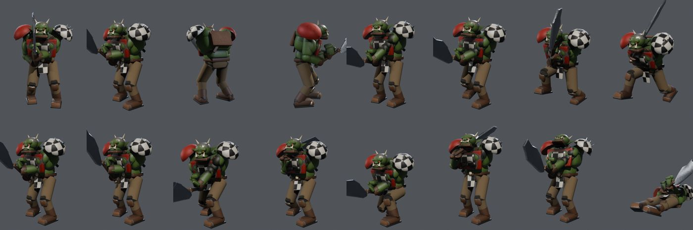

# Grimdark Tactics — Warhammer 40,000 팬 메이드 실시간 전술 전투

Total War: WARHAMMER 40,000 티저의 분위기를 목표로 만든 **브라우저 3D 실시간 전술 전투**입니다.
PC(마우스·키보드)와 휴대폰·태블릿(터치)에서 설치 없이 링크 하나로 실행됩니다.

> 비공식 팬 제작 프로젝트입니다. Games Workshop, Creative Assembly, SEGA와 관련이 없으며
> 원작의 모델·텍스처·영상·사운드를 사용하지 않았습니다. 모든 3D 모델과 애니메이션은 이 저장소의
> Blender 스크립트로 직접 생성했습니다.

**바로 플레이: https://totoaji314-dot.github.io/wh40k-grimdark-tactics/** (로그인·설치 없이 PC·휴대폰·태블릿에서 실행)

`main` 브랜치에 push하면 GitHub Actions가 테스트·빌드 후 `gh-pages` 브랜치를 갱신하므로 새 버전도 같은 주소에서 실행됩니다.





| 근접전 | 참호선 | 휴대폰 화면 |
|---|---|---|
|  |  |  |

## 진영과 병종

| 진영 | 부대 (기본 병력) | 병종 모델 |
|---|---|---|
| 스페이스 마린 | 전술 분대 ×2, 데바스테이터 분대 (30) | 볼터 마린, 플라즈마 마린, 헤비 볼터 마린, 서전트(체인소드+볼트 피스톨) |
| 아스트라 밀리타룸 (카디안) | 보병 소대 ×2, 중화기 소대, 지휘 소대 (100) | 라스건 병사, 플라즈마 거너, 헤비 스터버 거너, 서전트, 장교(파워 소드·그레이트코트) |
| 데스 코어 오브 크리그 | 전열 중대 ×3, 중화기 중대 (100) | 총검 라스건 병사, 헤비 스터버 병사, 워치마스터 |
| 오크 | 보이즈 몹, 슈타 보이즈, 워보스+놉즈, 보이즈 (100) | 보이(초파+슬러가), 슈타 보이, 놉(빅 초파), 워보스(파워 클로+콤비 슈타) |

진영마다 **골격 비율·실루엣·장비·걸음걸이가 모두 다릅니다**: 마린은 2.1m 파워 아머로 무겁게 걷고,
크리그는 무릎까지 오는 코트와 방독면·호스·철모, 카디안은 위장복·방탄판·고글 헬멧,
오크는 구부정한 거대한 상체와 긴 팔, 엄니와 붉은 눈, 고철 갑옷과 체크무늬 견갑을 가집니다.

## 모델 (Blender 렌더 미리보기: 자세 4방향 + 애니메이션 12프레임)






| 병종 | 삼각형 LOD0 / LOD1 / LOD2 |
|---|---|
| 스페이스 마린 | 약 20,200 / 4,400 / 1,150 |
| 카디안 | 약 7,400–9,500 / 1,600–2,100 / 420–500 |
| 크리그 | 약 8,300–9,000 / 1,800–2,000 / 460–490 |
| 오크 | 약 12,400–13,800 / 2,700–3,000 / 720–790 |

## 모델·리깅·애니메이션 파이프라인 (`tools/blender`)

- `kit.py` — 형상 생성기, 공용 휴머노이드 리그(IK 발·손 목표, 견갑·허벅지판 추종 본, 근육 블렌드 가중치),
  Cycles GPU 베이크(알베도+AO, ORM, 노멀, 이미시브), LOD, glTF 내보내기
- `factions.py` — 4개 진영 16개 병종의 메시·재질·체형 설계
- `anims.py` — 17개 애니메이션: 대기, 경계 조준, 걷기, 조준하며 걷기, 달리기, 돌격, 방향 전환, 사격,
  재장전, 근접 공격 A/B, 피격, 사망 A/B, 엄폐, 엄폐 사격, 지휘(명령)
  - 발은 IK로 땅에 고정하고 보폭·주기에서 이동 속도를 계산해 **발 미끄러짐 없음**
  - 손은 무기 그립에 IK로 고정되어 **무기가 손에서 떨어지지 않음**
- `build.py` — 진영 빌드(베이크 → LOD 3단계 → 애니메이션 → 병종별 GLB + 미리보기 시트)
- `env.py` — 고딕/산업 폐허 환경 키트 26종(무너진 쌍탑·첨탑·장미창·플라잉 버트레스를 가진 대성당, 매뉴팩토럼, 합 블록, 예배당, 벙커, 굴뚝, 참호 벽, 모래주머니 등)

```bash
blender -b --factory-startup -P tools/blender/build.py -- marines local_only/models/marines
blender -b --factory-startup -P tools/blender/env.py -- local_only/env
node tools/build_models.mjs        # GLB 압축(meshopt) + 텍스처 WebP 변환
node tools/build_env.mjs
```

## 전투 시스템 (`src/sim`)

- 병사마다 독립 판단: 표적 선택, 사선 확인(건물·벽 차단), 조준·연사·재장전, 근접 상대 선택, 피격·사망
- 부대 단위 명령과 진형: 이동(경로 탐색 A*), 공격, 돌격, 정지, 달리기, 자유 사격, 전열·종대·산개·방어 진형
- 병사는 진형 슬롯을 따르되 장애물은 개인 경로로 돌아가고, 서로 겹치지 않도록 분리
- 정지한 부대는 주변 참호·모래주머니·벽·포탄 구덩이로 **엄폐** (명중률 감소)
- 사거리별 명중률, 장갑·관통력, 제압(사격을 받으면 명중·속도 저하, 몸을 숙임), 피로, 돌격 충격(질량 비교)
- 사기: 손실·제압·후방 공격·주변 패주로 하락, 지휘관 오라·승세로 상승 → 동요 → 패주 → 재집결
- 진영 특성: 마린 패주 없음, 크리그 참호전 강화, 오크 무리 규모 보너스와 와아아그, 카디안 일제사격
- 적 AI 지휘관: 오크는 무리 돌격과 워보스 후속 투입, 제국군은 엄폐 사격·역돌격·방어 진형

## 그래픽 (`src/render`, `src/world`)

- GPU 인스턴싱 + 본 행렬 텍스처 스키닝: 병종·LOD당 드로우 1회로 수백 명이 각자 다른 애니메이션 재생, 애니메이션 크로스페이드
- 거리별 LOD 3단계, 화면 밖 병사 컬링, 건물은 재질별 정적 배칭
- 절차적 타일 PBR 텍스처(지형 5층 스플랫, 건물 15종 재질), 베이크된 AO, 환경광(IBL), 그림자
- 총구 섬광, 레이저·볼트·플라즈마 탄도, 피격 불꽃·먼지, 폭발, 화재 연기 기둥, 굴뚝 연기, 동적 섬광 조명
- 해 질 녘 조명: 낮은 태양의 긴 그림자, 태양 쪽은 주황·반대쪽은 차가운 회청색 하늘과 환경광, 불타는 잔해 주변의 깜빡이는 불빛
- 원경: 하늘 셰이더로 그린 3겹 고딕 하이브 도시(바늘 첨탑, 거대 지구라트, 깜빡이는 창문 불빛, 피어오르는 연기 기둥)와
  전장을 둘러싼 실제 3D 폐허 도시 블록(그림자 계산 제외, 품질에 따라 밀도 조절), 멀리서 타오르는 큰 불
- 지면 디테일: 잔해 바위·석재 조각·녹슨 철골, 바람에 흔들리는 마른 풀, 불탄 나무, 포탄 구덩이에 고인 물
- 블룸, 색보정·비네트, 안개, 원거리 포격 섬광
- 효과음은 WebAudio로 실시간 합성(라스건·볼터·스터버·플라즈마·슈타·폭발·근접·와아아그 함성)

## 조작

**배치 단계** 전투 시작 전 파란 구역 안에서 부대를 자유롭게 배치(즉시 이동·회전·전열 폭) → 전투 시작 버튼 또는 Enter

**커스텀 전투** 전장·양측 부대(부대별 수량)·공중 지원·드롭 포드 횟수를 직접 편성

**부대 모드와 지원** M 근접전 모드 · V 경계 모드 · X 견제 모드 · L 그룹 진형 고정 · 왼쪽 위 ✈ 공중 지원(썬더볼트 기총 소사·폭격) · ⬇ 드롭 포드(전술 분대 강하)

**PC** 좌클릭 선택 · 드래그 범위 선택 · 우클릭 이동/공격 · 우클릭 드래그로 전선 방향과 폭(열·행 수) 지정 · 더블 우클릭 달리기 · Ctrl+숫자 부대 그룹 지정, 숫자 그룹 선택 · Alt+1~4 진형 ·
WASD/화살표 카메라 · Q/E 회전 · 휠 확대 · H 정지 · R 달리기 · C 돌격 · F 자유사격 · G 능력 · 1~4 진형 · Space 일시정지 · +/- 배속

**모바일/태블릿** 부대 카드·깃발 탭 선택 → 땅 탭 이동 / 적 탭 공격 · 길게 눌러 달려 이동 ·
한 손가락 드래그 이동 · 두 손가락 확대·회전·기울기 · 오른쪽 명령 버튼 · 가로 화면 권장

## 그래픽 품질과 성능

`설정 → 그래픽 품질`: 자동 / 낮음(디벗·저사양) / 중간 / 높음(PC). 자동은 기기(모바일 여부, 메모리, 코어, GPU 이름)로 선택합니다.

측정 (개발 PC: RTX 4060 Laptop, Chrome, 1600×900):

| 전투 | 병력 | 품질 | FPS |
|---|---|---|---|
| 불굴의 30인 (마린 30 vs 오크 100) | 130명 | 높음 | 165 (모니터 최대치), 근접전 중에도 유지 |
| 대 와아아그 | 530명 | 높음 | 165 |
| 대 와아아그 ×2 | 1,060명 | 높음 | 93–165 |
| 대 와아아그 ×2 | 1,060명 | 낮음 | 161–166 |
| 휴대폰 화면 에뮬레이션 (CPU 4배 감속) | 130명 | 자동(중간) | 49–116 |
| 휴대폰 화면 에뮬레이션 (CPU 4배 감속) | 530명 | 낮음 | 43–131 |
| 태블릿 화면 에뮬레이션 (CPU 4배 감속) | 530명 | 자동(중간) | 34–84 |

에뮬레이션은 CPU만 느리게 하고 GPU는 개발 PC의 것을 그대로 쓰므로 실제 기기보다 높게 나올 수 있습니다.

실제 안드로이드 디벗 기기의 GPU에서는 측정하지 못했습니다. 디벗에서는 `낮음`을 권장하며, 실측값을 알려주시면 조정하겠습니다.

## 보고서

[구현 현황](docs/IMPLEMENTATION_STATUS.md) · [모델·애니메이션 감사](docs/MODEL_AND_ANIMATION_AUDIT.md) · [설정 고증](docs/LORE_REFERENCE.md) · [성능](docs/PERFORMANCE_REPORT.md) · [테스트](docs/TEST_REPORT.md) · [에셋 권리](docs/ASSET_LICENSES.md)

## 개발

```bash
npm install
npm run dev        # http://localhost:5180
npm test           # 5개 시나리오 AI 대 AI 헤드리스 전투 테스트
npm run build      # dist/ (GitHub Pages 배포물)
```

`?viewer&f=marines,orks` 모델 뷰어 · `?auto=marines_vs_orks&q=low` 바로 전투 시작(테스트용)

## 제공된 모델에 대하여

작업 폴더의 `Rifleman.glb`를 검사했습니다(CC0, Gobkit). 3,272 삼각형, 13개 본, 7개 애니메이션을 가진
**2등신 카툰 병사**로 스페이스 마린이 아니며 이 게임의 사실적인 스타일과 맞지 않아 사용하지 않았습니다.
원본 파일은 수정·삭제하지 않았습니다.

## 오픈소스

three.js · meshoptimizer · glTF-Transform · Vite (모두 MIT), Blender(GPL, 제작 도구로만 사용).
